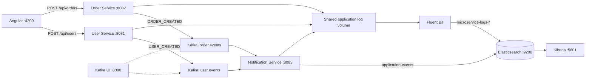

# Event-Driven Microservices with Kafka and Elasticsearch


A Backend / DevOps portfolio project demonstrating asynchronous communication between Java microservices, searchable domain events, and centralized application logs. A minimal Angular page submits user and order requests to the existing REST APIs.

## Architecture

Eight Docker Compose services support two independent flows: domain events through Kafka and application logs through Fluent Bit. Angular runs separately on the host.



| Component | Responsibility |
| --- | --- |
| User Service | Accept name/email and publish a JSON user event |
| Order Service | Accept product/integer price and publish a JSON order event |
| Kafka | Transport events on `user.events` and `order.events`; KRaft mode, no ZooKeeper |
| Notification Service | Consume both topics and index domain events |
| Elasticsearch | Store domain events and application logs in separate indices |
| Fluent Bit | Tail shared log files and forward records to Elasticsearch |
| Kafka UI / Kibana | Inspect messages / search indexed documents |
| Angular + TypeScript | Single-page forms with required-field validation, feedback, and pending submission guards |

### Event-driven communication

Producers use Spring Kafka's `KafkaTemplate` with a JSON serializer. Both endpoints return HTTP `201` with the event body. Publishing is asynchronous: an HTTP success does not prove that the consumer has indexed the event. There is no user/order database, authentication, or email delivery in this implementation.

Notification Service uses `@KafkaListener`, string deserialization, and consumer group `notification-service-group`. It logs the received message and calls `ElasticsearchEventService`. The `application-events` document contains `eventType` (from the message's `type`), `sourceTopic`, `payload` (the original JSON as a string), and an indexing-time `timestamp`. Elasticsearch generates the document ID. This implementation does not provide end-to-end exactly-once delivery or event deduplication.

### Centralized logging

Compose sets `LOGGING_FILE_NAME` for each Spring service. A shared `microservice-logs` volume stores the three application log files; console logging remains enabled. Fluent Bit reads active `*-service.log` files through a read-only mount and writes daily `microservice-logs-YYYY.MM.DD` indices with `log`, `source_file`, and collection-time `@timestamp` fields.

Tail offsets and buffered chunks persist in `fluent-bit-state`. Retries are unlimited, generated IDs reduce duplicates during batch retries, and the output queue is capped at 1 GB. Multiline messages remain separate records. Collection is best effort; long outages, rotation, oversized lines, or exhausted storage can cause loss. See the [logging guide](fluent-bit/README.md) for details.

## Repository layout

```text
.
|-- docker-compose.yml
|-- services/
|   |-- user-service/          # Java 21 / Spring Boot 3.4.5 producer
|   |-- order-service/         # Java 21 / Spring Boot 3.4.5 producer
|   `-- notification-service/  # Consumer and Elasticsearch writer
|-- fluent-bit/                # Tail/output configuration and logging guide
|-- frontend/                  # Angular 21 application and npm lockfile
|-- frontend-service/          # Reserved placeholder, not a Compose service
|-- src/                       # Original root Spring scaffold, not used by Compose
|-- pom.xml                    # Original independent scaffold, not a multi-module build
|-- mvnw / mvnw.cmd             # Maven wrapper
`-- README (1).md              # Retained historical documentation
```

The root scaffold uses its own Java 17 / Spring Boot 4.1.1 configuration. Build the services under `services/` or use Docker; the root Maven project does not build the three microservices.

## Run locally

### Prerequisites

- Git, Docker Desktop or Docker Engine with Compose v2, and enough memory for Kafka, Elasticsearch, Kibana, and three JVM services.
- Node.js compatible with Angular 21 and npm. This integration pass used Node `24.11.0` and npm `11.6.1`.
- Java 21 and Maven only for service builds outside Docker. Dockerfiles provide their own build toolchain.
- Free ports: `4200`, `5601`, `8080` through `8083`, `9092`, and `9200`.

### Install and start

```bash
git clone <YOUR_REPOSITORY_URL>
cd elastic-kafka-microservices-demo
docker compose config -q
docker compose up --build -d
docker compose ps -a
```

Wait for Kafka, Elasticsearch, and the Spring services to initialize. Compose uses startup ordering, not readiness health checks. Kafka has a host listener at `localhost:9092` and a container listener at `kafka:29092`.

In a second terminal:

```bash
cd frontend
npm ci
npm start
```

Open **http://localhost:4200**. The page uses HttpClient to call `http://localhost:8081/api/users` and `http://localhost:8082/api/orders`. CORS permits this exact development origin, POST, and Content-Type; OPTIONS preflight is handled by Spring. Use `localhost`, not `127.0.0.1`, for the frontend origin.

| Interface | URL |
| --- | --- |
| Angular | http://localhost:4200 |
| Kafka UI | http://localhost:8080 |
| Elasticsearch | http://localhost:9200 |
| Kibana | http://localhost:5601 |

Stop without removing stored data:

```bash
docker compose stop
```

Elasticsearch data, application logs, and Fluent Bit state use named volumes. Do not remove volumes when retaining data. Kafka has no explicitly configured named data volume; do not rely on broker data surviving container recreation.

## REST API examples

These are the actual controller contracts. The examples below use Bash; in Windows PowerShell use `Invoke-RestMethod` as shown afterward.

```bash
curl -i -X POST http://localhost:8081/api/users \
  -H 'Content-Type: application/json' \
  -d '{"name":"Portfolio User","email":"portfolio@example.com"}'
# HTTP 201
# {"type":"USER_CREATED","name":"Portfolio User","email":"portfolio@example.com"}

curl -i -X POST http://localhost:8082/api/orders \
  -H 'Content-Type: application/json' \
  -d '{"product":"Laptop","price":25000}'
# HTTP 201
# {"type":"ORDER_CREATED","product":"Laptop","price":25000}
```

```powershell
Invoke-RestMethod -Method Post -Uri http://localhost:8081/api/users `
  -ContentType 'application/json' -Body '{"name":"Portfolio User","email":"portfolio@example.com"}'
Invoke-RestMethod -Method Post -Uri http://localhost:8082/api/orders `
  -ContentType 'application/json' -Body '{"product":"Laptop","price":25000}'
```

`price` is a Java `int`, with no currency or fractional-unit contract. The UI accepts nonnegative whole numbers up to `2147483647`. Frontend validation does not add server-side DTO validation; direct API clients must supply appropriate values.

Check CORS (use `curl.exe` in PowerShell):

```bash
curl -i -X OPTIONS http://localhost:8082/api/orders \
  -H 'Origin: http://localhost:4200' \
  -H 'Access-Control-Request-Method: POST' \
  -H 'Access-Control-Request-Headers: content-type'
```

Expect HTTP 200, `Access-Control-Allow-Origin: http://localhost:4200`, and POST in allowed methods. Repeat for `http://localhost:8081/api/users`.

## Inspect events and logs

### Kafka UI

Open http://localhost:8080, select cluster **local**, open **Topics**, and select `user.events` or `order.events`. In the messages view, read from the beginning or a recent offset. Submit a form and find its `type` and matching name/product. Topics may only appear after the first publication.

### Elasticsearch

```bash
curl 'http://localhost:9200/application-events/_search?pretty&size=10'
curl 'http://localhost:9200/_cat/indices/microservice-logs-*?v'
curl 'http://localhost:9200/microservice-logs-*/_search?pretty&size=5'
```

To find a specific event, run in Kibana **Dev Tools**:

```json
GET application-events/_search
{
  "query": { "match_phrase": { "payload": "Portfolio User" } }
}
```

### Kibana Discover

1. Open http://localhost:5601 and go to **Stack Management > Data Views**.
2. Create `application-events` using `timestamp` as its time field.
3. Create `microservice-logs-*` using `@timestamp` as its time field.
4. Open **Discover**, select the relevant data view, and choose a time range containing your requests.
5. For events, display `eventType`, `sourceTopic`, and `payload`. For logs, display `log` and `source_file`.

Example KQL filters:

```text
eventType : "USER_CREATED"
source_file : "/var/log/microservices/notification-service.log"
log : "Received"
```

Data views are manual setup; they are not provisioned by Compose.

## Testing and troubleshooting

```bash
docker compose config -q
docker compose ps -a
docker compose logs --tail 100 user-service order-service notification-service fluent-bit
cd frontend
npm run build
npm test -- --watch=false
```

The Angular test exercises both rendered forms with mocked HTTP, exact request bodies, duplicate submission prevention, and success/error feedback. It does not replace a real browser test against the backend. See [VERIFICATION.md](VERIFICATION.md) for the final integration commands, actual results, and manual checks.

| Symptom | Check |
| --- | --- |
| Browser cannot submit | Exact origin `http://localhost:4200`, service ports, OPTIONS response, browser Network panel |
| Order rejected or not submitted | Price must be a whole number within the Java int range |
| HTTP 201 but no indexed event | Producer logs, Kafka topic contents, consumer group, notification logs, Elasticsearch availability |
| Kafka unavailable at startup | Wait for broker readiness and inspect service logs; restart affected service if necessary |
| No logs in Discover | Data view/time range, Fluent Bit logs, `microservice-logs-*` indices, shared log volume |
| Container name/port conflict | Inspect existing containers; do not stop unrelated projects |
| Root Maven build differs | Root scaffold is independent; use Compose or a specific service POM |

This is a local demonstration environment. Elasticsearch security is disabled and exposed ports bind to all host interfaces by default; keep it on a trusted local machine. Authentication, TLS, and deployment hardening are future work.

## Future improvements

- Backend request validation and structured error responses.
- Automated integration tests using isolated Kafka and Elasticsearch instances.
- Delivery acknowledgments, idempotent indexing, retry/dead-letter policies.
- Health checks and readiness-aware startup.
- Structured JSON logs and multiline handling.
- Explicit Kafka persistence and log retention policies.
- CI build/test checks and externalized deployment configuration.

These are proposals, not implemented infrastructure.

