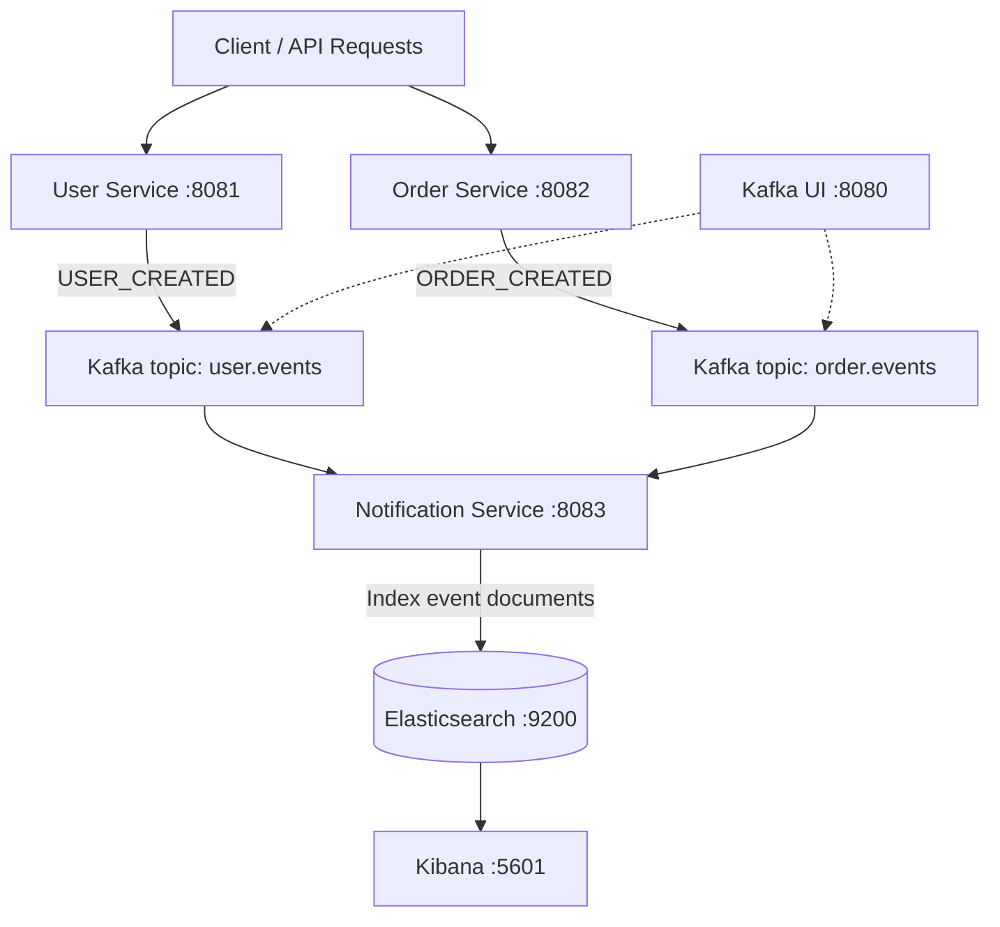

# Event-Driven Microservices with Kafka & Elasticsearch

<p align="center">
  
  
  
  
  
</p>

A hands-on **event-driven microservices demo** built with **Spring Boot, Apache Kafka, Elasticsearch, Kibana, and Docker Compose**. It demonstrates how independent services publish domain events, how a dedicated consumer processes those events asynchronously, and how they can be indexed in Elasticsearch for search and inspection.

> **Project status:** The core Kafka → consumer → Elasticsearch pipeline has been tested with `USER_CREATED` and `ORDER_CREATED` events. A frontend and Fluent Bit integration are not yet implemented.

## Architecture



### Services and infrastructure

| Component | Port | Responsibility |
| --- | --- | --- |
| **User Service** | `8081` | Handles user requests and publishes `USER_CREATED` events |
| **Order Service** | `8082` | Handles order requests and publishes `ORDER_CREATED` events |
| **Notification Service** | `8083` | Consumes Kafka events and writes them to Elasticsearch |
| **Apache Kafka** | `9092` / `29092` | Asynchronous event transport (listener depends on network context) |
| **Kafka UI** | `8080` | Inspection of Kafka topics and messages |
| **Elasticsearch** | `9200` | Stores searchable event documents |
| **Kibana** | `5601` | Searches and explores indexed events |

## Tech stack

- **Backend:** Java, Spring Boot, Maven
- **Messaging:** Apache Kafka (producer / consumer model)
- **Search and analytics:** Elasticsearch 8.15.3, Kibana
- **Infrastructure:** Docker, Docker Compose
- **Interfaces:** REST APIs and event messages

## How it works

1. A client creates a user or an order using the corresponding REST API.
2. The service publishes a domain event to its Kafka topic.
3. **Notification Service**, running with consumer group `notification-service-group`, receives the event.
4. The consumer stores the event in the Elasticsearch index **`application-events`**.
5. The indexed document can be explored in Kibana or queried directly from Elasticsearch.

### Example event data

**User created**

```json
{
  "eventType": "USER_CREATED",
  "name": "Furkan",
  "email": "furkan@test.com"
}
```

**Order created**

```json
{
  "eventType": "ORDER_CREATED",
  "product": "Laptop",
  "price": 25000
}
```

> These examples illustrate event content; the exact serialized payload and any additional fields depend on the service implementation.

## Getting started

### Prerequisites

- [Docker](https://docs.docker.com/get-docker/) and the Docker Compose plugin
- Git
- Java and Maven **only if** running or building services outside Docker (use versions compatible with the project's `pom.xml` files)

### 1. Clone the repository

```bash
git clone <YOUR_REPOSITORY_URL>
cd elastic-kafka-microservices-demo
```

Replace `<YOUR_REPOSITORY_URL>` with the GitHub repository's HTTPS or SSH URL.

### 2. Start the application stack

From the repository root:

```bash
docker compose up --build -d
```

Check the status and inspect logs:

```bash
docker compose ps
docker compose logs -f
```

> The command assumes the checked-in `docker-compose.yml` defines the required application and infrastructure services. Check environment variables and service configuration before starting the stack.

### 3. Explore the tools

| Tool | Local URL |
| --- | --- |
| Kafka UI | http://localhost:8080 |
| Elasticsearch | http://localhost:9200 |
| Kibana | http://localhost:5601 |

Initial startup may require additional time while Elasticsearch and Kibana become ready.

## Test the event pipeline

Use Postman or another HTTP client to send sample requests.

**Create a user**

```bash
curl -X POST http://localhost:8081/api/users \
  -H "Content-Type: application/json" \
  -d '{"name":"Furkan","email":"furkan@test.com"}'
```

**Create an order**

```bash
curl -X POST http://localhost:8082/api/orders \
  -H "Content-Type: application/json" \
  -d '{"product":"Laptop","price":25000}'
```

> Request bodies may need adjustment to match the current DTOs and validation rules in each service.

**Inspect indexed events**

```bash
curl "http://localhost:9200/application-events/_search?pretty"
```

Look for documents with `USER_CREATED` and `ORDER_CREATED` values. You can also inspect `user.events` and `order.events` in **Kafka UI**, then use **Kibana** to explore the `application-events` index.

## Useful Docker commands

```bash
# List running containers
docker compose ps

# View notification-service logs (verify the service name in Compose)
docker compose logs -f notification-service

# Stop containers without deleting volumes
docker compose down
```

## Current scope and roadmap

**Implemented and tested**

- [x] User and order services publishing events to Kafka
- [x] Kafka topics: `user.events` and `order.events`
- [x] Notification Service consuming domain events
- [x] Elasticsearch indexing into `application-events`
- [x] Kibana and Kafka UI available for inspection
- [x] Docker-based builds and runtime verification

**Planned improvements**

- [ ] Add structured log collection with Fluent Bit
- [ ] Add a frontend to interact with the services
- [ ] Add automated integration tests for the event pipeline
- [ ] Improve configuration management and secret handling
- [ ] Add health checks, retry handling, and observability documentation
- [ ] Introduce CI checks for builds and tests

## Learning outcomes

This project is designed to demonstrate practical experience with:

- **Microservice communication** using asynchronous messages
- **Event-driven architecture** and Kafka topics/consumer groups
- **Indexing and querying** event data using Elasticsearch
- **Inspecting distributed workflows** with Kafka UI and Kibana
- **Containerized local environments** using Docker Compose

## Notes

This repository is a **learning and demonstration project**, not a production-ready deployment. Before using it in a production environment, review authentication, network exposure, credentials, resource limits, failure handling, persistence, and monitoring. In particular, do not expose an unsecured Elasticsearch instance to the public internet.

---

<p align="center"><strong>Built to explore real-world messaging, microservices, and search infrastructure.</strong></p>
